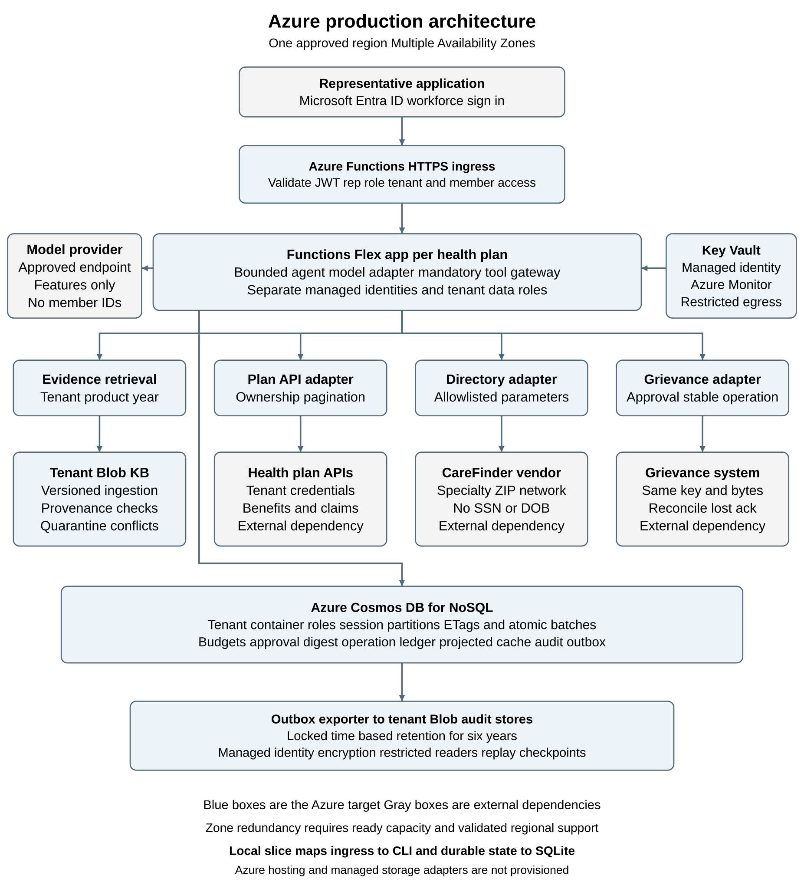

# Member services Azure architecture

[Design PDF](Design_Brief.pdf) contains four content pages plus one architecture diagram. [Editable source](Design_Brief.docx) and [request flow](FLOW.md) are included.

The platform supports two health plans while keeping each conversation scoped to one tenant and member. The working slice is a Python CLI with supplied HTTP APIs, validated plan evidence and SQLite. Azure is the primary production target. The design below specifies managed hosting and state; those services are not provisioned by the local slice.

## Primary deployment and data boundaries

Microsoft Entra ID authenticates representatives. Each health plan has its own Azure Functions Flex Consumption app and managed identity. HTTPS ingress validates JWT signature, issuer, audience and representative role, then derives tenant scope and authorises member access. The same application package runs in both apps. Every tool call passes the mandatory application gateway. Model requests contain minimised routing features only; the approved provider endpoint remains configurable.

Container scoped data-plane roles restrict each identity to its tenant Cosmos DB for NoSQL container and Blob KB and audit stores. Session partitions hold leases, budget reservations, approval digests, canonical grievance bodies, projected claim cache and audit outbox. ETags and same-partition transactional batches protect state changes. Versioned Blob ingestion checks tenant, product, year and provenance. Key Vault stores tenant API credentials; managed identities, private data paths and restricted external egress limit access.

## Availability cost latency and scale

Choose one approved region supporting the selected zone features. Zone-redundant Flex requires at least two always-ready instances per configured scaling group, so it does not scale to zero. Price every HTTP and export group before approval. Regional loss and external-provider outages remain risks. The 99.99 percent monthly objective permits about 4.32 minutes in a 30-day month; end-to-end availability needs canaries, dependency SLOs and recovery exercises.

At 20,000 conversations daily, USD 0.03 allows USD 600 per day in model plus hosting cost. A USD 0.025 model ceiling leaves USD 100 per day for hosting at full allocation; this is a budget envelope, not a cloud quote. Measure Cosmos throughput, ready instances, storage and telemetry. Define turn rates for 250 concurrent reps, test bursts and tenant fairness, and confirm model/API quotas. Fresh 1.5-second sequential claim pages cannot universally satisfy a complete answer below three seconds; seek upstream aggregation or an approved freshness contract.

## Verification and operational evidence

Local checks pass 86 tests. Rules baseline: 37/40 and p95 4.625 seconds; three source conflicts keep quality red. A live OpenAI smoke passed; the latest full attempt scored 17/40 with 23 HTTP 429 failures. Both live gates fail. No complete live, hosting-cost, peak-load or six-year archive validation is claimed.

# Threat model and operation protocol

Protected assets are member facts, tenant credentials, representative authorisation, approval evidence, durable operations and audit records. Untrusted inputs include free text, plan files, claim notes, vendor manifests, pagination links and provider errors. The local CLI trusts its operator; the Azure target adds authenticated ingress and tenant-scoped service identities.

| Boundary | Threat | Control |
| --- | --- | --- |
| Caller to session | Forged scope or direct ingress | Validate JWT issuer, audience, signature and rep role; derive tenant; authorise member in the function. |
| Tenant worker to data | Cross tenant data access | Separate apps and identities; container scoped Cosmos and Blob roles; gateway member and cache checks. |
| Sources to agent | KB, notes or vendor injection | Provenance quarantine, reviewed schemas and structured evidence; no model write authority. |
| Application to API | Wrong owner, hostile links or disclosure | Bound paths, claim ownership and pagination checks; restricted egress and no raw member context to model. |
| State to grievance | Replay or lost acknowledgement | Approval digest, expiry, lease and ETag conditions; identical key and bytes; reconcile uncertain writes. |
| Audit and budget | Tampering, PHI or quota exhaustion | Safe event schema, atomic outbox and locked retention; bounded calls, quotas, cost reservation and deadlines. |

## Confirmed write and audit flow

A filing request creates a DRAFT and displays the minimised summary. Only explicit representative confirmation of the member-agreed text can create APPROVED state. The approval binds tenant, member, session, operation and exact body digest, and expires if unsent. Persist IN_FLIGHT before POST; retry the same key and exact bytes after an uncertain response. Persist COMPLETED before reporting success. Unconfirmed drafts can be cancelled; an uncertain operation must be reconciled.

Persist each critical state change and its audit outbox event in the same Cosmos session-partition batch. A checkpointed exporter writes safe events into tenant Blob stores under locked six-year time-based retention. Reconcile outbox lag and replay after interruption. Local SQLite is not an immutable archive. Exactly-once effect still requires the grievance system to retain its idempotency records; restarting the supplied mock discards them.

## Residual risk and recovery

A compromised worker can access its own tenant's authorised data. Misconfiguration, stale cache, model misclassification, exhausted quotas and regional outages remain risks. Use reviewed data roles, protected keys and archives, expiry checks, restore drills and alerts for denied scope, pending writes and export lag. Provider store=false is not a retention agreement. Production rollout requires identity, storage, failure, load and cost evidence.

# Mapping Azure deployment to AWS

For year-two hosting in a client's AWS account, preserve session, evidence, approval and operation contracts while replacing cloud adapters. Keep each deployment in one approved region. This mapping is a portability design; it does not establish equivalent price, quotas or availability.

| Responsibility | Azure primary | AWS counterpart |
| --- | --- | --- |
| Workforce identity | Entra ID and validated JWT roles | Cognito workforce federation; revalidate tenant claims |
| HTTPS ingress | Functions HTTP endpoint and JWT checks | API Gateway JWT authorizer with scoped Lambda routing |
| Tenant runtime | Separate Functions Flex apps and identities | Separate Lambda functions and IAM execution roles |
| Durable state | Cosmos tenant containers; ETags and session batch | DynamoDB scoped tables; conditional TransactWriteItems |
| Plan evidence | Tenant Blob containers and provenance checks | Tenant S3 stores and the same ingestion manifests |
| Immutable audit | Locked Blob retention and checkpointed outbox | S3 Object Lock retention and the same outbox contract |
| Secrets and keys | Managed identities and Key Vault | IAM roles, Secrets Manager and KMS |
| Operations | Azure Monitor, alerts and private data paths | CloudWatch, alarms and scoped VPC endpoints |

## Migration invariants

Preserve authorised tenant identity, session and operation IDs, canonical request bytes and approval digests. Cosmos ETag checks and same-partition batches map to DynamoDB conditional transactional writes. Retest lease fencing, duplicate confirmation and cost reservations against the new store. Both designs require application expiry checks rather than relying on asynchronous TTL deletion.

Transfer versioned KB content with provenance manifests; re-issue scoped credentials and external egress policy. Keep old audit archives under their originating retention controls until migration requirements are satisfied. Exporting a blob does not transfer its immutability policy. Re-run quality, isolation, write recovery, restore, latency, load and full cost checks before cutover.

[AWS Lambda resilience](https://docs.aws.amazon.com/lambda/latest/dg/security-resilience.html)

[Amazon S3 Object Lock](https://docs.aws.amazon.com/AmazonS3/latest/userguide/object-lock.html)

# Architecture decision records

## ADR 1 Tenant isolation and policy gateway

Context: backend tokens do not prove tenant ownership. Decision: separate tenant apps and identities and bind every tool to an authorised session, with ownership checks. Alternatives: one broad identity or prompt-only isolation. Consequences: more deployment objects and policy tests, with smaller data-access scope per worker.

## ADR 2 Structured versioned evidence

Context: documents contain multiple years and conflicting tenant provenance. Decision: validate metadata and retrieve structured evidence by tenant, product, year and effective date. Alternatives: vector-only retrieval or folder-only filtering. Consequences: reproducible citations and closed failures on conflict; prose-only extensions need a reviewed parser.

## ADR 3 Durable approved operation

Context: an upstream write can commit before a 503. Decision: use session-partition Cosmos batches, approval hashes and a stable key/body, with IN_FLIGHT persisted before POST. Alternatives: new keys per retry or model-managed consent. Consequences: recovery depends on durable upstream idempotency; all writes need conditional state adapters and race tests.

## ADR 4 Bounded projected claim cache

Context: sequential claim pages dominate latency. Decision: date-aware complete retrieval and a 30-second conversation/member cache, displayed age and a fresh-read option. Alternatives: global raw-record caches or speculative page fan-out. Consequences: bounded staleness and lower repeated-read latency; fresh complete counts can still exceed three seconds.

## ADR 5 Azure region and replaceable services

Context: approved spend covers one region and year-two portability. Decision: Functions Flex with selected zone redundancy, Cosmos and Blob adapters; retain the existing model boundary. Alternatives: always-on Kubernetes or multi-region hosting. Consequences: ready-capacity cost and regional failure exposure remain; AWS migration requires semantic identity and transaction tests.

## Azure design references

[Functions Flex hosting and ready capacity](https://learn.microsoft.com/en-us/azure/azure-functions/flex-consumption-plan)

[Cosmos DB transactional batches](https://learn.microsoft.com/en-us/rest/api/cosmos-db/transactional-batch)

[Cosmos DB container scoped data roles](https://learn.microsoft.com/en-us/azure/cosmos-db/how-to-connect-role-based-access-control)

[Blob immutable retention](https://learn.microsoft.com/en-us/azure/storage/blobs/immutable-storage-overview)

# Azure architecture diagram

Figure 1  Azure single-region target with tenant identity and durable-state boundaries
