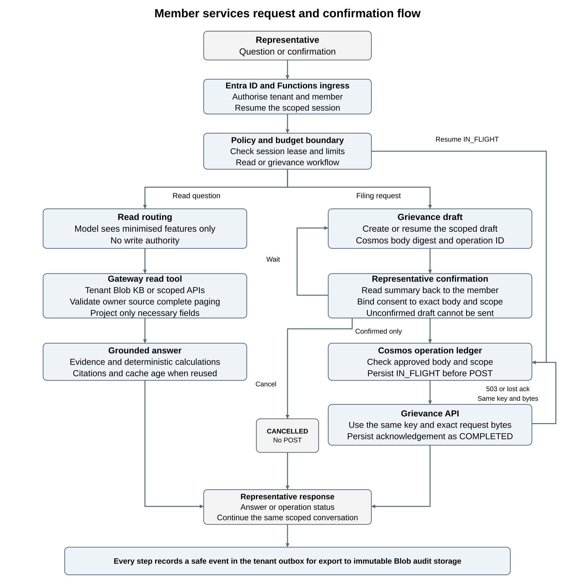
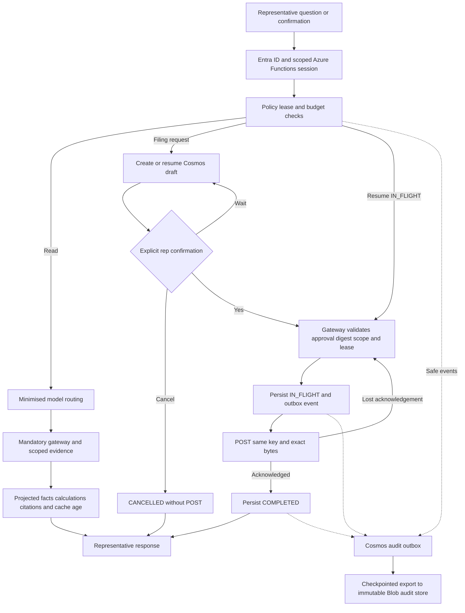

# Azure request and confirmation flow

This diagram follows one conversation through the Azure production target. Each health plan has a separate Functions app and managed identity. Entra identity validation and member authorisation establish the trusted scope before the application processes a question or confirmation. The local implementation provides these application flows through its trusted CLI and SQLite; Azure hosting and managed-state adapters are not deployed.

[Download PNG](request_flow.png) · [Editable SVG](request_flow.svg) · [Mermaid source](request_flow.mmd)

Read questions use the bounded model router and mandatory gateway. The model receives fixed-vocabulary features. Scoped plan evidence and API results pass ownership, provenance, pagination and projection checks before deterministic answer rendering, citations and displayed cache age.

Grievance drafts and confirmations are handled by application policy. A representative reads the summary back to the member and explicitly confirms. The gateway checks the approval digest, scope and lease, and the expiry of an unsent approval, before Cosmos state becomes IN_FLIGHT. An existing IN_FLIGHT operation resumes at reconciliation using its original operation ID, key and body. Lost acknowledgements retain that same operation; successful acknowledgements are persisted before success is reported. Cancelling an unsubmitted draft cannot create a backend grievance.

Critical state changes and outbox records share a Cosmos session-partition transaction. A checkpointed exporter writes safe events into the tenant's Blob audit store under a locked time-based retention policy. This preserves the event trail across an exporter interruption. The downstream grievance service must retain idempotency state for the one-effect guarantee to hold.

The [deployment architecture](architecture.svg) places these flows in Azure. The [design brief](DESIGN.md) contains the threat model, five ADRs and one-page AWS portability mapping. Current validation limits, including exhausted model quota and unmet cold-claim latency, remain in the [README](../README.md#tests-and-evaluation).

## Flow source

